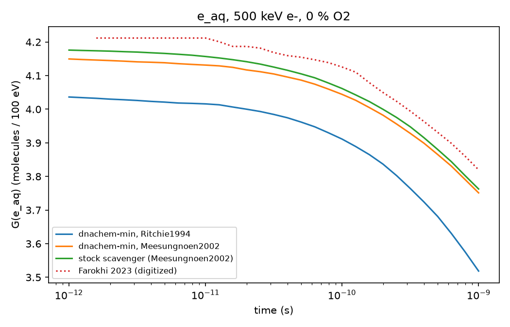

# e_aq G at 1 ps, 500 keV e-, 0 % O2

| Source | G(1 ps) | SEM | vs stock |
|---|---|---|---|
| dnachem-min, Ritchie1994 | 4.036 |  | -3.3 % |
| dnachem-min, Meesungnoen2002 | 4.150 | 0.006 | -0.6 % |
| stock scavenger (Meesungnoen2002) | 4.176 | 0.006 | +0.0 % |
| Farokhi 2023 (digitized) | 4.212 |  | +0.9 % |

Farokhi's digitized value carries a reading error of about 0.1-0.2 G units (about 3.5 %).

## Finding

The 3.3 % gap to the stock Geant4-DNA `scavenger` example (and 4 % to Farokhi) was mostly the electron solvation subtype:
dnachem-min's Farokhi macros set `Ritchie1994`, the example sets `Meesungnoen2002`. With `Meesungnoen2002`
(`macro/beam_farokhi_electron_o2_0pct_meesungnoen.in`, 250 events, eLossMin 12.5 keV) dnachem-min is 0.6 % below the stock run,
inside the 1 % target, and 1.5 % below the digitized Farokhi value, inside its reading error. The remainder is consistent with
the B1A1 autoionisation probability (0.55 stock vs 0.50 option1), see `dissociation_channels_comparison.md`; it was not isolated.
Boscolo (4.49) comes from a different code and is not a target.
